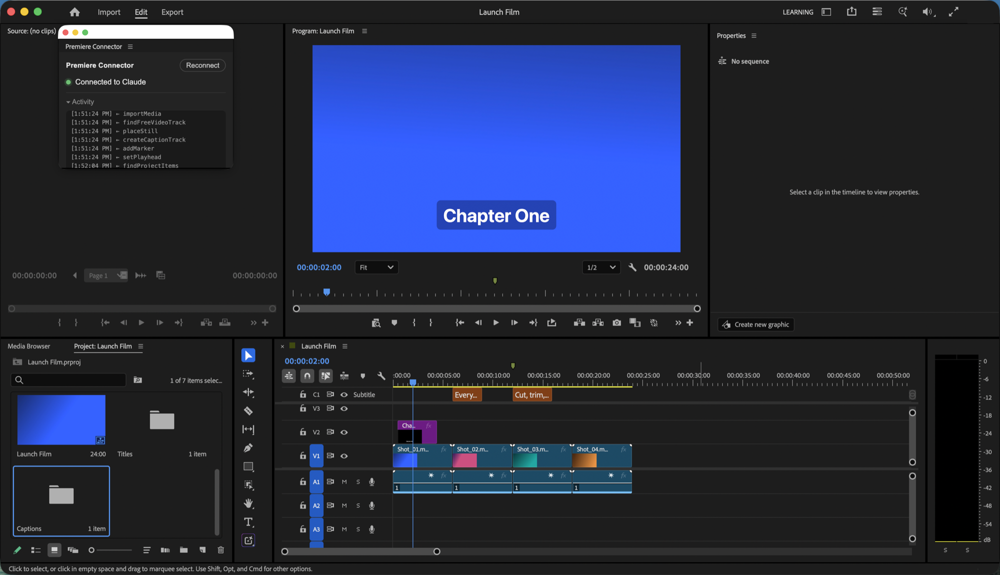

# Premiere Connector

Edit in Adobe Premiere Pro by talking to Claude. Premiere Connector is a [Model Context Protocol](https://modelcontextprotocol.io) (MCP) server and a small Premiere panel that give Claude about 150 tools for cutting, trimming, speed changes, effects, keyframes, transitions, titles, captions, audio levels, markers and exports. It can also render a frame, so Claude *sees* the result of an edit.

It comes with a **skill**: the order to work in and the rules learned from real projects, so Claude doesn't repeat the mistakes that break a timeline (clips that can't be extended, duplicated templates, invisible characters lost from text).


Premiere Connector started from [antipaster/Adobe-Premiere-Pro-MCP](https://github.com/antipaster/Adobe-Premiere-Pro-MCP) (MIT) and has been extended a great deal since, together with the skill.



## How it works

```
Claude ⇄ MCP server (Node.js) ⇄ WebSocket (localhost) ⇄ "Premiere Connector" panel in Premiere ⇄ ExtendScript ⇄ Premiere Pro
```

Everything runs on your Mac or PC. The panel is signed with a self-signed certificate, so Premiere loads it **without turning on CEP debug mode** (`PlayerDebugMode`).

## Requirements

- Adobe Premiere Pro 2023 or newer (tested on 26.5, macOS Apple Silicon)
- Adobe Media Encoder (installed with Creative Cloud; used for export presets and frame previews)
- Node.js 18+
- Claude Code or Claude Desktop
- macOS or Windows

## Install

### macOS

```bash
git clone https://github.com/zahediamrei/premiere-connector.git
cd premiere-connector
./install.sh
```

### Windows

```bat
git clone https://github.com/zahediamrei/premiere-connector.git
cd premiere-connector
install.bat
```

The installer:
1. builds the MCP server,
2. downloads Adobe's `ZXPSignCmd`, creates a self-signed certificate and signs the panel,
3. installs the signed panel into your user CEP extensions folder,
4. registers the server with Claude Code (`claude mcp add -s user`) and Claude Desktop,
5. installs the skill for Claude Code in `~/.claude/skills/premiere-connector`. For Claude Desktop, add the `skill/premiere-connector` folder as a skill in Settings.

Then:
1. Restart Premiere Pro.
2. Open **Window → Extensions → Premiere Connector** (dock it anywhere; it can stay small).
3. Start or restart Claude. The panel shows **Connected to Claude** while Claude is running.

Re-run the installer after updating the code.

## Using it

Ask for edits in plain language, for example:

- "Cut out 0:12–0:18 from the whole timeline and close the gap."
- "Put clip *interview_02* on V1 after the last clip, using 5s to 32s of it."
- "Speed up the second clip to 200% and push everything after it."
- "Add a slow zoom from 100% to 115% on the first clip, eased."
- "Add a title *Chapter One* at the bottom from 0 to 4 seconds with a dark box."
- "Put the library graphic *Lower Third* at 0:10 with photo.jpg as its image and this text: …"
- "Change the photo in the graphic on V3 to new.jpg."
- "Make captions from this transcript" (editable Premiere caption track), or burned-in TikTok-style captions.
- "Lower the music on A2 to -12 dB and fade it out over the last 3 seconds."
- "Show me the frame at 1:05" (Claude receives a rendered image).
- "Export the sequence as YouTube 1080p to my Desktop."

Conventions the tools use: times are in **seconds**; tracks are **0-based** (V1 = video track 0, A1 = audio track 0); clips are addressed by track + clip index from left to right (indexes change after edits, and Claude re-reads the timeline).

## Tools

| Area | Tools |
|---|---|
| Status | `get_status` |
| Project | `get_project_info` `new_project` `open_project` `save_project` `save_project_as` `close_project` `import_media` `get_project_items` `find_project_items` `get_project_item_info` `create_bin` `rename_project_item` `move_project_item` `delete_project_items` `set_project_item_in_out` `clear_project_item_in_out` `create_subclip` `relink_media` `refresh_media` `attach_proxy` `create_proxy` `toggle_proxies` `set_project_item_label` `set_scale_to_frame_size` `set_override_frame_rate` `set_override_pixel_aspect_ratio` `consolidate_duplicates` `import_ae_comps` `import_sequences` `set_scratch_disks` `select_project_items` `get_project_panel_selection` |
| Sequence | `get_sequences` `get_active_sequence` `set_active_sequence` `create_sequence` `create_sequence_from_clips` `clone_sequence` `rename_sequence` `delete_sequence` `close_sequence` `get_sequence_settings` `set_sequence_settings` `set_sequence_in_out` `clear_sequence_in_out` `add_tracks` `remove_track` `remove_empty_tracks` `get_track_info` `set_track_muted` `set_track_locked` `set_track_targeted` `rename_track` `auto_reframe_sequence` `scene_edit_detection` `create_subsequence` |
| Timeline | `get_timeline_clips` `get_clip_info` `find_clips` `get_clips_at_time` `insert_clip` `overwrite_clip` `append_clip` `remove_clip` `move_clip` `move_clip_to_track` `trim_clip` `razor_clip` `razor_all_tracks` `ripple_delete_range` `close_gaps` `set_clip_speed` `set_clip_enabled` `rename_clip` `link_clips` `unlink_clip` `slip_clip` `slide_clip` `duplicate_clip` `get_selection` `select_clips` `deselect_all` |
| Effects | `get_effects_list` `apply_effect` `remove_effect` `get_clip_effects` `get_effect_property` `set_effect_property` `add_keyframe` `get_keyframes` `remove_keyframe` `clear_keyframes` `set_keyframe_interpolation` `get_clip_transform` `set_clip_transform` `get_transitions` `apply_transition` `remove_transition` |
| Audio | `get_clip_volume` `set_clip_volume` `fade_clip_volume` `set_clip_channel_volume` `get_track_volume` `set_track_volume` `set_clip_mute` |
| Titles & captions | `add_text` `list_mogrts` `import_mogrt` `get_mogrt_properties` `set_mogrt_property` `list_library_graphics` `import_library_graphic` `get_mogrt_media` `replace_mogrt_media` `place_mogrt_with_media` `add_captions` `import_captions` `add_text_captions` |
| Markers | `add_marker` `add_markers` `get_markers` `update_marker` `remove_marker` `clear_markers` `add_clip_marker` `get_clip_markers` `add_project_item_marker` `get_project_item_markers` |
| Export | `get_export_presets` `export_sequence` `queue_export` `export_frame` `export_audio` `export_fcp_xml` `export_aaf` `export_omf` `export_sequence_as_project` `render_previews` |
| Playback | `set_playhead` `get_playhead` `go_to_edit` `play` `stop` `open_in_source_monitor` `get_source_monitor` `get_workspaces` `set_workspace` `undo` `redo` |
| Metadata | `get_project_columns` `set_project_column` `get_xmp_metadata` `set_xmp_metadata` |
| Advanced | `execute_extendscript` |
| AI voice (optional) | `elevenlabs_list_voices` `elevenlabs_generate_speech` `elevenlabs_voice_lines` |

## Known limits of Premiere's scripting API

- Text inside Premiere's own titles (Essential Graphics made in Premiere) can't be read or changed by script. `add_text` renders titles as transparent images with the system text engine (any font; right-to-left and complex scripts are shaped correctly); After Effects `.mogrt` templates are editable via `set_mogrt_property`.
- Premiere can't set a template's Media Replacement slot by script, so the tools work around it. `replace_mogrt_media` changes the image of a template clip already on the timeline: it rebuilds the template's After Effects data with your image and relinks the clip to it, so the clip keeps its position, text, settings, effects and keyframes. If other clips use the same template, only the chosen clip changes (it is swapped for an identical copy with its settings carried over; keyframed template values are not carried over), unless you ask for `scope: "all"`. `place_mogrt_with_media` places a new template with your images. Slots that use the same image inside the template change together. Rebuilt templates are saved in `~/Documents/Premiere Connector/mogrt/`.
- Caption tracks can be created (from text or a caption file) but not read back.
- Track pan, solo and the work-area bar are not scriptable. Stereo clips can be balanced with `set_clip_channel_volume`.

## Configuration

`config.json` (created by the installer from `config.example.json`):

| Setting | Description | Default |
|---|---|---|
| `port` | Local WebSocket port between the server and the panel | `8095` |
| `elevenlabs.api_key` | ElevenLabs key for the optional voiceover tools (or `ELEVENLABS_API_KEY`) | `""` |
| `elevenlabs.default_voice_id` | Default voice | `21m00Tcm4TlvDq8ikWAM` |
| `elevenlabs.default_model` | TTS model | `eleven_multilingual_v2` |

Generated files (title images, caption files, frames, voiceovers) are saved in `~/Documents/Premiere Connector/`. Keep them: the project references them.

## Troubleshooting

- **Panel says "Waiting for Claude…"**: Claude isn't running, or the server isn't registered. Run `claude mcp list` and check `premiere-connector` is there.
- **Premiere Connector is missing from Window → Extensions**: restart Premiere after installing; re-run the installer.
- **A tool times out**: Premiere may be showing a dialog. Close it and retry.
- **Panel shows "Script load failed"**: reopen the panel; if it persists, re-run the installer.

## Development

`npm run dev` rebuilds the server on change. To iterate on the panel without re-signing, symlink `cep/` into the CEP extensions folder, enable `PlayerDebugMode`, and add a `cep/.debug` file for remote debugging. `scripts/dev-bridge.mjs` stands in for the MCP server so you can call panel functions with curl, and `scripts/e2e-test.mjs` runs an editing scenario through the real MCP server (on a scratch project only).

## Architecture

```
src/                MCP server (TypeScript)
  server.ts         entry point and usage instructions for Claude
  bridge.ts         WebSocket bridge to the panel
  textRender.ts     text → PNG with the OS text engine
  tools/            tool definitions, one file per area
cep/                Premiere panel (CEP)
  CSXS/manifest.xml
  index.html, js/main.js   connection + dispatch
  jsx/              ExtendScript implementation, one file per area
install.sh          macOS installer
install.bat         Windows installer (runs scripts/install-windows.ps1)
```

## The skill

`skill/premiere-connector/SKILL.md` is plain text Claude reads before working in Premiere. When you hit a new Premiere problem and solve it, add it there as a rule: the symptom, the cause and the correct method.

## Credits

Built on [antipaster/Adobe-Premiere-Pro-MCP](https://github.com/antipaster/Adobe-Premiere-Pro-MCP), released under the MIT licence. Its licence notice is kept in [LICENSE](LICENSE).

## License

MIT. Made by [zahediamrei](https://github.com/zahediamrei).
